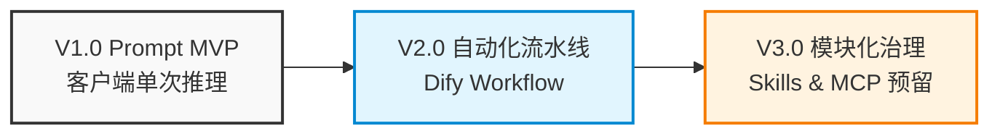

# Job Matching Agent

> An LLM-powered Job Matching & Resume Strategy Agent. 
> (面向求职场景的 AI 智能体工作流实践：从 Prompt 验证到模块化解耦的架构演进)

## 📖 项目简介 (Introduction)

面对海量的招聘 JD，求职者往往需要花费大量时间进行筛选和定制简历。本项目旨在通过大语言模型（LLM）的能力，打造一个“AI 求职匹配智能体”。系统通过比对**目标 JD**、**个人全量能力档案**与**求职意向岗位池**，输出深度的匹配度评估、投递建议，以及极具针对性的“简历策略与潜力挖掘”方案。

**本项目不仅是一个实用工具，更是一次关于 AI 工程化的架构实践。** 完整记录了从 MVP 验证、自动化 Workflow 到模块化 Skill 架构演进的全过程。


## 🚀 架构演进史 (Architecture Evolution)

本项目的设计遵循了**从简单到复杂，从验证到工程化**的原则。



### [V1.0: Prompt 驱动的 MVP](./v1_prompt_mvp/)
核心思路：将「JD + 档案 + 岗位池」一次性打包给强模型，利用“长上下文”与“思维链 Prompt”进行单次深度推理。

测试结论：验证了复杂任务可以通过设计优良的 Prompt 完成；对比发现，静态任务下 Agent 的“过度拆解”反而带来噪音，确立了“单次强推理”的基线。（查看 V1 测试详情）

### V2.0: Workflow 自动化流水线 (Coming Soon)
核心思路：为了解决 V1 客户端无法自动化、批量处理的问题，引入本地私有化部署的 Dify。

架构设计：拆解为“JD 解析（多模态提取） -> 综合评估 -> 结构化输出”的固定 Workflow。

### V3.0: 模块化与 Skill 封装 (Coming Soon)
核心思路：摒弃巨型节点的耦合，将核心能力抽离为独立的 AI Skill。

架构设计：每个 Skill 包含独立的 Prompt 与 JSON Schema，为未来接入 MCP (Model Context Protocol) 及外部 Agent 生态预留标准接口。


## 📊 核心架构权衡 (Design Decisions)
在设计过程中，我做出了几个关键的架构决策（点击链接查看详细思考）：

1. 数据输入策略：为什么摒弃直接上传“简历”，而采用“全量能力档案 + 意向岗位池”的复杂架构？

2. 技术选型权衡：为什么在当前阶段暂不使用 RAG（检索增强）和 Function Calling（工具调用）？

3. Agent vs Workflow：在静态文件输入场景下，Workflow 的确定性远胜于 Agent 的自主规划。Agent 的价值将留待需要联网搜索、自动投递等动态场景时再行释放。


## 📁 仓库结构 (Repository Structure)

```
job-matching-agent/
├── input_files/                               # 核心共享输入：模板与测试数据
│   ├── template_profile.md                    # 全量档案模板（供用户直接套用）
│   ├── template_job_pool.md                   # 意向岗位池模板
│   ├── mock_profile.md                        # 虚构的全量档案（用于测试展示）
│   ├── mock_job_pool.md                       # 虚构的岗位池
│   └── mock_jd_screenshot.png                 # 参考公开 JD 制作的虚构 JD 截图
│
├── v1_prompt_mvp/                             # V1: 客户端验证阶段
│   ├── prompts/super_prompt_v1.md             # 经过验证的超级 Prompt
│   ├── results/doubao_expert_mode_result      # 跑出的 Markdown 分析报告示例截图
│   └── README.md                              # V1 阶段测试记录与结论
│
├── docs/                                      # 架构设计文档与思考记录
│   ├── architecture_evolution.md
│   ├── input_data_strategy.md
│   └── design_decisions.md
│
└── (V2 & V3 目录即将更新...)
```

## ⚡ 快速开始 (Quick Start)
如果你想体验 V1 阶段的能力（无需本地部署，仅需一个强 LLM 客户端）：

1. 下载 input_files/ 目录下的 template_profile.md 和 template_job_pool.md，按照模板提示填入具体内容。

2. 准备一份目标岗位的 JD 截图。

3. 复制 v1_prompt_mvp/prompts/super_prompt_v1.md 中的 Prompt。

4. 打开 Kimi、豆包 (专家模式) 或 ChatGPT 等客户端，上传上述三个文件并粘贴 Prompt。

5. 你将获得一份极具深度的个人能力诊断报告。

## 🗺️ Roadmap (项目规划)
- [x] V1.0：完成 Prompt MVP 验证与输入数据模板设计。
- [ ] V2.0：完成 Dify Workflow 编排，打通自动化输入与结构化输出。
- [ ] V3.0：完成 Skill 拆解，编写 mcp_manifest.json，支持 MCP 协议。
- [ ] Future：接入 RAG 保护隐私，接入 Job Board API 实现自动岗位抓取。

## ⚠️ 数据隐私声明
本项目所有示例数据均为虚构（如：张三），不包含任何真实个人的联系方式与商业机密。
